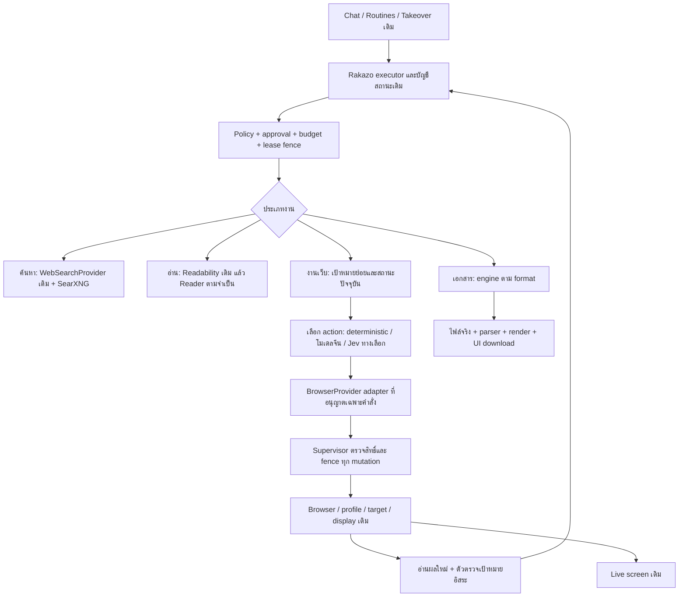

# แผนปรับกลยุทธ์ Rakazo จากซอร์สและหลักฐานจริง

วันที่ 15 ตุลาคม 2026 · ฉบับเสนอเพื่อหารือ · ยังไม่ใช่คำสั่งติดตั้งหรือ deploy

## ข้อเสนอหลัก

เก็บ Rakazo เป็นฐานผลิตภัณฑ์ แล้วเปลี่ยนชั้นควบคุมเว็บให้ใช้ส่วนประกอบที่ทดสอบและเปลี่ยนแทนกันได้ โดยมีผู้จัดการ session/สิทธิ์/หน้าจอหลักเพียงชุดเดียว ใช้โมเดลจีนเป็นหลัก แยกงานค้นคว้าออกจากงานคลิกจริง และย้ายงานจัดหน้าเอกสารไปหา engine ที่มีระบบ shaping/math/layout พร้อมใช้

นำ open source มาใช้เต็มส่วนที่มีประโยชน์ได้ ทั้ง dependency, executable, service หรือแนวทางออกแบบ แต่ทุกส่วนต้องมีหน้าที่ที่ไม่ซ้ำ พร้อมเกณฑ์พิสูจน์ผล ประโยชน์ต้องวัดจากงานสำเร็จจริง ค่าใช้จ่าย และภาระดูแล ไม่วัดจากจำนวนโครงการที่ติดตั้ง

คำแนะนำเริ่มต้น: ทดลอง **Playwright-based adapter กับ agent-browser** เป็นคู่เทียบตัวขับเว็บ บน computer เดิมของ Rakazo; ทดลอง **โมเดลจีนประหยัดกับ Jev** เป็นคู่เทียบผู้เลือก action บนตัวขับเดียวกัน จากนั้นค่อยพิจารณา browser-use/Stagehand/Skyvern สำหรับความสามารถที่ยังขาด

ข้อเสนอนี้ยังไม่ตัดสินว่าตัวใดชนะ เพราะยังไม่ได้ทดลองกับ runtime/เว็บจริงของเรา การอ่านซอร์สรอบนี้เริ่ม paid model runs ใหม่ 0 ครั้ง

## ขอบเขตการอ่านและความเชื่อมั่น

ตรวจ inventory ของ **32 repositories รวม 102,475 ไฟล์** ดาวน์โหลดไฟล์ที่เลือก 265 ไฟล์ และอ่านเนื้อหาหรือส่วนที่เกี่ยวข้องใน 86 ไฟล์ พร้อม source ปัจจุบันของ Rakazo บน Oracle และ PDF ต้นทาง 11 หน้า

**ยังไม่ได้อ่านทุกไฟล์ทุกบรรทัดของทุกโครงการ** และไม่ได้ตรวจ dependency graph ทั้งหมด จำนวน inventory/ดาวน์โหลดไม่ใช่จำนวนไฟล์ที่อ่านครบ ก่อนนำตัวใดเข้าระบบจริงต้องอ่านเส้นทางเรียกใช้และ dependencies ของตัวนั้นเพิ่มตามรายการตรวจด้านล่าง

ดู [ขอบเขตการอ่านและ commit อ้างอิง](C:/Users/User/Documents/Codex/2026-10-13/antigravity-chat-d-2-2/outputs/strategy-review-20261015/SOURCE_REVIEW_COVERAGE.md), [รายการตัดสินใจทั้ง 32 โครงการ](C:/Users/User/Documents/Codex/2026-10-13/antigravity-chat-d-2-2/outputs/strategy-review-20261015/COMPONENT_DECISIONS.json) และ [ตัวเลขขอบเขตที่ตรวจ](C:/Users/User/Documents/Codex/2026-10-13/antigravity-chat-d-2-2/outputs/strategy-review-20261015/REVIEW_SCOPE.json) แต่ละ repository ถูกตรึง commit เพื่อให้ตรวจซ้ำได้ รุ่น main ที่อ่านไม่ใช่ release ที่อนุมัติให้ deploy

## สิ่งที่ตรวจพบและต้องแก้ความเข้าใจจากข้อเสนอเดิม

1. **สเปกเครื่องไม่ตรงเอกสาร:** Oracle ปัจจุบันเป็น x86_64, 2 CPU, RAM 11,496 MiB และ swap 4,095 MiB ณ ครั้งที่อ่าน มี MemAvailable ประมาณ 7,400 MiB ตัวเลขนี้เป็นภาพขณะพัก ไม่ใช่ความจุรองรับโหลด เอกสารอิง ARM64/24 GB จึงใช้ประมาณการติดตั้งทั้งชุดตรง ๆ ไม่ได้
2. **Rakazo มี search/reader อยู่แล้ว:** `web-provider-factory.ts` ใช้ `KeylessHttpWebProvider`; `keyless-http-web.ts` ค้นผ่าน DuckDuckGo HTML และอ่านด้วย Mozilla Readability; executor เรียก `webSearchFromTool` อยู่แล้ว ควรเพิ่ม SearXNG/Reader ที่ขอบเขต provider นี้ มากกว่าสร้างเส้นทางใหม่ทั้งหมดใน PluginsOverlay
3. **มี idle disable แล้ว:** source บน Oracle มี `computerIdleSleepEnabled()` ตรวจ `SANDBOX_IDLE_MS="0"` ทั้ง schedule และ sleep path จึงไม่ควรดึง PR ตามคำอ้างเก่าซ้ำโดยยังไม่ดู diff ส่วนจะเปิดค่านี้หรือไม่เป็นอีกการตัดสินใจเรื่อง session/ทรัพยากร
4. **ข้อเสนอแก้ `pi-runtime-tool-dispatch.ts` ไม่ตรง tree ที่ตรวจ:** ไม่พบ implementation ชื่อนี้ใน source local/upstream ที่อ่าน แต่มี `pi-runtime-tool-dispatch.test.ts`; ส่วน soft-stop ที่ยืนยันได้อยู่ใน `pi-runtime.ts` และเกี่ยวกับ tool-call budget ต้องตาม host/dispatcher ที่รุ่นจริงใช้ก่อนกำหนดแพตช์
5. **`undici-fetch.ts` ปัจจุบันเป็นตัวจับคู่ transport/Response/FormData:** ไฟล์นี้ไม่มี `headersTimeout/bodyTimeout` ตามข้อเสนอ ต้องตามจุดสร้าง Agent/dispatcher และ timeout ของ model stream เพิ่ม การเพิ่มตัวเลขลงไฟล์ผิดจุดจะไม่แก้สาเหตุ
6. **มี timeout/retry หลายชั้น:** `pi-runtime-limits.ts` มี time-to-headers 120 s, stream idle 180 s และ retry setting; `provider-error-retry.ts` มี retry เฉพาะ empty provider error ก่อนมี partial output อยู่แล้ว ต้องระบุชั้นที่เป็นเจ้าของ retry และนับค่าใช้จ่ายทุก attempt
7. **snapshot จำกัดหลายระดับ:** helper local ที่อ่าน default 80 และรับ limit ได้ถึง 200 ขณะที่ navigate response ส่ง 40 elements แรกให้โมเดล ปัญหาจึงเป็นทั้ง selection, truncation และ contract ไม่ใช่แก้เลข 80 ตัวเดียว
8. **มีต้นเหตุภายในที่เคยพิสูจน์แล้ว:** dedicated computer เคยไม่มี monotonic screen fence ข้ามรัน, click input ไม่ยืนยันปลายทาง และ takeover อาจเกิดก่อนพบฟอร์ม ปัญหาเหล่านี้ไม่ได้หายด้วย proxy/stealth หรือใช้โมเดลแพงขึ้น
9. **grader ยังเป็นความเสี่ยง:** รอบตรวจที่ผ่านมาเจอ false PASS ต่อข้อมูลเสีย/URL ผิด/หลักฐานเก่า ต้องแก้ oracle แยกจาก agent ก่อนอ้างว่า engine ใหม่ดีขึ้น คำว่า Zero False Positive ต้องจำกัดว่าเป็นผลของชุดใดและเวอร์ชันใด
10. **GitHub เก่าไม่ใช่ตัวแทน production:** local มี modified/untracked code มาก และ server มีแพตช์ใหม่ ห้ามอาศัยข้อความ “นำหน้า 25 ตามหลัง 104 commits” เป็นฐาน merge ต้อง freeze source/runtime จริงแล้วทำสามทางเทียบกับ upstream

หลักฐาน source สำคัญบน Oracle: computer-lifecycle `9211842a…`, executor `758feb89…`, browser-recovery `9a431a0e…`, provider-error-retry `6b70f725…`, undici-fetch `2731ef55…` สำเนาที่อ่านอยู่ `work/strategy-review-20261015/runtime-source/` ไม่ได้แก้ไฟล์เหล่านี้

## สถาปัตยกรรมที่เสนอ

ส่วน “เลือก action” และ adapter ใหม่เป็นขอบเขตที่เสนอ ยังไม่ได้มี implementation ตามภาพนี้ครบใน Rakazo ปัจจุบัน แผนนี้ไม่เพิ่ม scheduler/chat/state store อีกชุด

### สัญญาที่ทุก engine ต้องรักษา

- ทุกการสังเกต/กระทำระบุ `computerId, runId, leaseFence, browserSessionId, targetId, frameId, documentGeneration, observationId` ตามที่เกี่ยวข้อง ห้ามเดาแท็บแรกหรือเลือกตามชื่อบอตอย่างเดียว
- ผลแยกอย่างน้อยเป็น `dispatched`, `applied`, `verifiedOutcome`, `failedBeforeDispatch`, `uncertain` และ error code; ห้ามให้ library คืน success แล้วแปลเป็น goal success ทันที
- ref ผูกกับ document/frame/observation ที่เห็นจริง การเปลี่ยนหน้า/แทน DOM ต้องตรวจใหม่ ชื่อ ref เดิมไม่ได้รับประกันว่าชี้สิ่งเดิมตลอด
- มีผู้ขับที่เขียนสถานะหนึ่งรายต่อ computer/target ที่กำหนด เมื่อผู้ใช้ Take Control หรือ Stop ต้องยกเลิกอำนาจการกระทำของ worker เก่า รวม pending input ที่ยังไม่ส่ง
- **ตรวจ fence ต่อ mutation ไม่ใช่เพียงตอนเริ่มเชื่อม CDP:** การเปิด connection ให้ library ใช้ยาว ๆ อาจปล่อย worker เก่าคลิกต่อหลังหมด lease ต้องทำผ่าน action gateway หรือ connection ที่เพิกถอนและจำกัดได้จริง ทั้ง callbacks/watchdogs/popups ต้องอยู่ในสัญญานี้
- เมื่อ timeout หลัง dispatch ให้สังเกตปลายทางก่อน ห้าม blind retry click/submit; transport retry ทำได้เฉพาะคำขอที่รู้ว่ายังไม่ส่ง effect
- ใช้ secret reference เดิม แก้ค่าจริงใน runtime เฉพาะ origin/field ที่อนุญาต ไม่ส่งค่าจริงให้ planner, Jev, text helper หรือ trace
- screenshot/artifact/live viewer ต้องอ้างจอและ generation เดียวกัน; screenshot ของแท็บอื่นหรือก่อน action ไม่ถือว่าตรวจผลแล้ว
- UI เว็บเป็นช่องทางรับงานและตรวจรับจริงเสมอ ผล offline/native/backend ต้องติดป้ายแยกกัน

## ใช้แต่ละโครงการตรงไหน

### ฐานและตัวขับเว็บ

- **Rakazo:** คงผลิตภัณฑ์เดิมและ provider interfaces ย้ายงานที่เปราะไป adapter ที่ชัดเจน คัด upstream fixes หลังเทียบ source จริง ไม่ rebase ทั้งชุดในรอบเดียว
- **Playwright / Playwright MCP:** เป็น baseline สำหรับ locator, auto-wait, browser attach และ assertions ใช้ SDK/adaptor หากเสียบเข้ากับ supervisor ได้ตรงกว่า MCP ส่วน MCP เหมาะเมื่อจำเป็นต้องใช้ข้ามระบบ ต้องไม่ให้เป็นทางลัดข้าม policy
- **agent-browser:** ตัวเลือกแรกที่ควรทดลองคู่ baseline มี compact AX snapshots, native CDP input, frame/document-aware refs และ persisted target binding ใช้ผ่านคำสั่งที่ code สร้างอย่างจำกัด ไม่เปิด arbitrary shell/evaluate/auth store ของมันให้โมเดลทั้งชุด
- **browser-use:** ทดลอง DOM extraction และ bounded agent worker เมื่อ baseline ยังทำงานลึกได้ไม่ดี รองรับ DeepSeek/OpenRouter ใน source แต่ adapter DeepSeek ที่อ่านมี `usage=None` ต้องต่อ usage/ราคาและ hard budget ให้ครบก่อนใช้งาน คุม internal LLM/extraction calls และ watcher actions ด้วย
- **OpenClaw:** เลือกแนวทาง target isolation, navigation/redirect checks, abort handling และ snapshot compaction มาใช้ ไม่ย้าย gateway หรือคัดไฟล์เดี่ยวที่ยังผูก plugin SDK โดยไม่ตาม dependencies
- **Stagehand:** เปรียบเทียบ observe → action และ cached workflows รุ่นที่อ่านเป็น 4.0.0 ใช้ RPC; ต้องอ่าน engine runtime เพิ่มก่อนตัดสินใจใช้ทั้งชุด กำหนด Chinese model/client callback ชัดเจน เพราะ default Model Gateway สามารถเลือกโมเดลราย call ได้
- **Skyvern:** เป็น worker เฉพาะฟอร์มซับซ้อนหลังมี reproducer ที่ engine หลักทำไม่ได้ พิจารณาเฉพาะเมื่อผ่าน lease/approval/usage และต้นทุน stack ที่เพิ่ม
- **Steel Browser:** เก็บเป็นตัวเลือกเปลี่ยน session host ในอนาคต และศึกษา recording/session context ไม่รัน session manager ใหม่คู่ supervisor เดิมโดยยังไม่ได้วางการเป็นเจ้าของ
- **Chrome DevTools MCP:** เครื่องมือ debug ตามเรียกสำหรับ console/network/target/performance ไม่ใช่สิทธิ์ให้บอตใช้ debugger ได้ทุกอย่าง และไม่เปิดพอร์ต CDP สาธารณะ
- **skill-agent-browser ชุมชน:** ไม่ติดตั้งตามคำโฆษณา มีคำแนะนำ refs “ใช้ตลอด” และ daemon แบบเก่าที่ไม่ตรงรุ่น source ทางการ ต้องใช้เป็นข้อมูลประกอบเท่านั้น

### Jev: ตัวเลือกที่ควรเพิ่มในการทดลอง

ควรทดลอง เพราะตรงกับความต้องการลดรอบ reasoning และใช้โมเดลจีน แต่ยังไม่ควรรับทั้ง demo มาคุม production

- **Jev Ultrafast ของ browser-use:** ใช้ indexed action space, operation/target questions พร้อมกัน, ตรวจความสดและ occlusion ก่อน input และแยก text generation เป็น helper เหมาะกับขั้นตอนสั้นที่เป้าหมายชัด
- ใน source ที่อ่าน `model.py` เรียก TypeSafe API โดยตรง การใช้ code MIT ไม่ได้ทำให้ Jev weights หรือบริการ hosted เป็น open source/self-host ได้ทั้งหมด ทุก decision ยังมี inference และต้องนับค่าใช้จ่าย ดู [ซอร์ส Jev Ultrafast](https://github.com/browser-use/jev-ultrafast) และไฟล์ที่ตรึง commit ใน coverage
- `snapshot.js` ตัด action เหลือ 250, อ่านข้อความที่เห็นสูงสุด 6,000 ตัวอักษร และตัด password/file/hidden fields ออกจาก candidate list; จึงต้องคง secret-fill เดิมไว้ เป็นข้อจำกัดการสำรวจ ไม่ใช่ proof ว่าปลอดภัยครบทุก widget
- README ระบุว่า frames, Shadow DOM, popup tabs, canvas, uploads และ nested scrolling อยู่นอก MVP ส่วน `Agent` รับ DONE แล้วตั้งสถานะ done ต้องมี verifier ภายนอกเพิ่มก่อน mapping เข้า Run completed ของเรา
- `Browser` เปิด target ใหม่ background และตั้ง viewport 1120×780 พร้อม focus emulation จึงยกมาใช้ตรง ๆ ไม่ได้กับข้อกำหนดว่าผู้ใช้ต้องเห็นจอ/แท็บเดียวกับบอต
- **tontoko/jev-browser:** ศึกษา typed decisions และ UI readback ที่แยก native/semantic verification เพิ่ม แต่ยังไม่เชื่อ claim ว่าครอบคลุม complex widgets จนกว่าจะอ่าน dependency closure และทดสอบ
- **dennisonbertram/jev-browser:** ศึกษา redaction ที่ resolve จาก observed nodes และ mask ก่อนจับภาพ ไม่ใช่แค่แทนข้อความหลังภาพหลุดไปแล้ว
- **jevnav:** นำแนวคิด trace/fingerprint/uniqueness/drift ไปทำ regression ราคาต่ำ แต่ replay ที่อ่านเป็นการ resolve element ไม่ได้ทำ effect ซ้ำหรือยืนยัน task outcome และ risk regex ไม่ครอบคลุมแทน policy เดิมโดยอัตโนมัติ

ทางเสียบที่แนะนำ: planner จีนกำหนด subgoal/ข้อความที่อนุญาต → provider เลือก operation/target จาก candidates สด → ตรวจ schema/ref/fence/policy → driver เดิมกระทำ → verifier อ่านผลจริง → ทำต่อหรือส่งกลับ planner เมื่อมี ambiguity/no progress

ทำคู่เทียบบน candidates/driver เดียวกัน: (A) deterministic เมื่อระบุเป้าหมายได้แน่ (B) Chinese model เลือก structured action (C) Jev เป็น opt-in มีเพดานค่าใช้จ่าย จึงวัดได้ว่าประโยชน์มาจาก model หรือจากการปรับ harness ห้ามวัดคนละ engine แล้วสรุปว่า Jev ชนะ

### Search / Reader / Proxy

- **SearXNG:** เพิ่ม backend JSON adapter ตรง `WebSearchProvider` คง `web_search` เดิม ไม่ต้องเปิด computer egress เข้า LAN เพื่อเรียกทุกครั้ง ตรวจ format/engine timeout/dedup/source URLs และแยก engine failed ออกจาก no results
- **Jina Reader:** ให้ Readability เดิมเป็นเส้นทางเบา จากนั้นเรียก Reader เมื่อ JS/PDF/Office จำเป็น เริ่ม stateless หรือบริการตามเรียก ตรวจเส้นทาง VLM ใน source และปิด vendor/model calls ที่ไม่ต้องการ ไม่สมมติว่า Reader ทั้งชุดเป็นเพียง HTTP parser เบา ๆ
- **Firecrawl:** ใช้เฉพาะ crawl/map/extract หลายหน้าที่มีความต้องการจริง Self-host ที่อ่านมีหลาย queue/storage services จึงไม่เหมาะติดทั้งชุดบน VM นี้เพียงเพื่ออ่าน URL เดียว
- **Patchright:** ใช้เมื่อเลือก Playwright-based driver และพิสูจน์ detection issue แล้ว การเปลี่ยน package ไม่ปรับ raw CDP client ของ Rakazo/agent-browser ตามไปด้วย
- **Camoufox:** browser lane แยกเมื่อต้องใช้ Firefox จริง profile ไม่สลับกับ Chromium ตรง ๆ และต้องตรวจ lifecycle/หน้าจอใหม่
- **nodriver:** พักเป็นตัวสำรองเพราะซ้ำ CDP driver หลัก รับมาเมื่อมีผลวัดชนะเฉพาะเคสและยอมรับภาระการดูแล
- **Rota:** มีบทบาทได้ในงาน public scraping หลาย IP หากต้องการจริง งาน signed-in ให้ใช้เส้นทาง IP คงที่ตาม session เมื่อจำเป็น ไม่หมุน IP เพื่อแก้ click/ref ที่ผิด
- Proxy และ CAPTCHA solver เป็นบริการเลือกใช้เมื่อมีหลักฐานว่าจำเป็น ไม่เป็น dependency หลักของ navigation ไม่แก้ CAPTCHA อัตโนมัติหรือเปลี่ยนเส้นทางข้อมูลส่วนตัวโดยยังไม่มีสิทธิ์งานนั้น

### Secrets / Operations / เอกสาร

- **Vaultwarden:** เพิ่มเป็น secret provider ภายหลังถ้าต้องการ vault ภายนอก ใช้การ resolve เฉพาะ item/origin/field ไม่ให้โมเดลเรียก Bitwarden CLI แล้วเห็นรหัสทั้งหมด ต้องตรวจ client/CLI เพิ่มต่างหาก การมี TOTP ไม่ทำให้ passkey/approval ทุกเว็บทำอัตโนมัติได้
- **LiteLLM:** มีประโยชน์เมื่อรวมการเรียกโมเดลหลาย worker และต้องคุม spend พร้อม reservation แต่เป็นชั้นที่เพิ่ม failure mode ต้องมี DB/ราคา/identity และทดสอบ fail-closed จริงก่อนพึ่งเป็น hard limit ส่วน enterprise ต้องตรวจ feature ที่ต้องใช้ ไม่อ้างว่า proxy เปล่า ๆ คุมงบได้ อ้างอิง [ข้อกำหนด budget และ reservation](https://docs.litellm.ai/docs/proxy/users)
- **Restic + pg_dump:** สำรองฐานข้อมูลกับ homes/artifacts อย่างสอดคล้อง เข้ารหัสนอก VM และทดสอบ restore ไป directory/instance แยก ไม่ทับ production หรืออ้าง restore ผ่านจาก exit code backup
- **Uptime Kuma:** ตรวจ service health, queue/worker heartbeat และอายุ backup พร้อมแจ้งปัญหา ข้อมูลนี้ไม่รับรองว่าบอตใช้เว็บไซต์สำเร็จ ห้าม restart production อัตโนมัติระหว่างมี active run เพื่อให้ health check เขียว
- **Tailscale:** คงเครือข่ายปัจจุบันไว้; **Caddy** เป็นทางเลือก TLS/domain; **cloudflared** เป็นทางเลือก external access เมื่อจำเป็น ไม่ติดทั้งสามซ้อนเพียงเพราะอยู่ในลิสต์ และไม่ใช้ Funnel เปิดบริการออกสาธารณะเพื่อให้ Jules เข้าง่าย
- **noVNC:** คง viewer/takeover เดิม แต่ต้องให้ supervisor เป็นเจ้าของ computer identity และสิทธิ์ input ไม่สร้างเครื่องดูจออีกชุด หรือให้ reconnect เปิด browser ที่เพิ่งสั่งปิดขึ้นใหม่
- **Pandoc:** ทดลองแปลงผ่าน document AST/templates สำหรับ DOCX/HTML/Markdown ไม่ถือเป็น PDF renderer ทุกกรณี; **Typst:** ทดลอง PDF/math engine มี shaping และ fraction layout ใน source แต่ยังต้องพิสูจน์ Thai line breaking/mark positioning/fonts และ form requirements จริง
- คง artifact API/UI/download เดิม เลือก engine ตาม format งาน XLSX/PPTX ใช้ format-specific libraries ที่ผ่าน QA หรือแปลงใน process แยก ไม่อ้างว่ารองรับจาก ZIP/XML ขั้นต่ำหรือเปลี่ยนนามสกุล ใช้ LibreOffice/เครื่องมือตรวจเป็นตัวเลือกที่ต้องอ่านและตรวจเพิ่ม ไม่ได้ audit ซอร์ส LibreOffice ในรอบนี้

## นโยบายโมเดลตามความต้องการผู้ใช้

1. ใช้รายชื่อโมเดลจีนที่ผู้ใช้อนุญาตจาก shared connection settings เช่นตระกูล DeepSeek/Qwen/GLM/Kimi/MiniMax ตาม capabilities ของรุ่นที่มีจริง ไม่ hardcode รายชื่อทั้งหมดเป็น fallback chain
2. deterministic code ทำ validation, arithmetic, parsing, rendering และ replay ที่ทำได้แน่ ไม่เสีย inference เพื่อยืนยันข้อมูลที่ parser ตัดสินได้
3. ใช้ Chinese model ประหยัดสำหรับ structured selection และงานข้อความทั่วไป ส่งเฉพาะ snapshot ย่อที่เกี่ยวข้อง มีการขยาย scope หากเป้าหมายถูกตัดออก
4. ใช้ Chinese vision-capable model เฉพาะเมื่อ DOM/AX ไม่พอ ไม่ส่งรูปไป text-only model และไม่ประกาศว่าระบบจับภาพไม่ได้เพราะโมเดลอ่านภาพไม่ได้
5. เพิ่มความสามารถเมื่อเจอ no progress/ambiguity ที่มีหลักฐานและยังอยู่ใน budget เดิม ไม่วนเพิ่ม reasoning/model size ทุกครั้งที่ engine ทำงานผิด
6. ไม่สลับเป็นโมเดลท็อปราคาแพงโดยเงียบ ๆ allowlist และเพดานราคาเป็นข้อบังคับที่ runtime; Jev เป็นบริการเสริมที่ต้องเลือกใช้แยกจากค่าเริ่มต้นจีน
7. นับ planner, selector, text helper, vision, extract, retries และ library-internal calls ทั้งหมดด้วย `parentRunId/callId` ที่ reconcile ได้ ค่าไม่ทราบไม่เป็นศูนย์ และห้ามนับซ้ำ gateway + provider เป็นสองรายจ่าย
8. ให้ retry owner หนึ่งชั้นต่อคำขอ พร้อม deadline/backoff/jitter/Retry-After ที่เหมาะกับ error; ห้าม replay partial tool effects การเพิ่ม retries=3 แบบรวมทุกชั้นยังไม่ได้รับการเสนอให้ทำ
9. ชุด benchmark ต้องใช้ model IDs, caps, inputs และราคาเดียวกันตามช่วงวัด รายงาน cost ต่อ **งานที่สำเร็จจริง** ร่วมกับ calls/time/unknown spend ไม่เลือกเฉพาะ runs ที่ผ่าน
10. ยังไม่เลือก model ID หรือสัญญาว่า local LLM บน VM 2 CPU จะเร็วพอ ต้องสำรวจ catalog/บัญชีที่ผู้ใช้มีและวัดกับงานจริงในขั้นทดลอง

## ลำดับทำงานที่เสนอ

### ระยะ 0 — ตรึงฐานและทำให้การวัดเชื่อถือได้

- เก็บ source/runtime/image/package hashes, current settings ที่ไม่เปิดเผย secrets และ dirty diff ของโค้ดจริง สร้าง baseline ที่กู้กลับได้โดยไม่ล้าง profile/history
- อ่าน call graph/dependency closure ของ adapter ที่จะทดลองครบ ทั้ง license, model defaults, telemetry, secret serialization, reconnect/close, cancellation และ internal actions
- แก้ grader ให้ผูก terminal evidence กับ run/target/origin/time/fence จริง URL ใช้ parser ตรวจ hostname ไม่ substring; PDF ใช้ parser/bytes/hash และเนื้อหา; ตรวจผลล้มเหลว/ขัดแย้ง/ไม่มีหลักฐานเป็น FAIL หรือ INCONCLUSIVE
- ใช้ positives จาก schema/runtime จริงพร้อม held-out negatives ที่ผู้แก้ไม่เห็นก่อน ห้ามทำ fixture สมมติที่ implementation เชื่อโดยง่าย แล้วเรียก verified positive
- ส่งมอบ baseline manifest, adapter conformance contract และ test fixtures ก่อนเริ่มเทียบ engines

### ระยะ 1 — Driver spike บนคอมพิวเตอร์เดิม

- เปรียบเทียบ Playwright-based adapter กับ agent-browser ผ่าน interface เดิม ใช้ candidate เดียวกันและโมเดลจีนเดียวกันเมื่อมีการตัดสินใจ
- ทำสั้น ๆ ให้ครบ attach, snapshot, click, fill/select, frame, popup, screenshot, download, close/detach, Stop และ takeover resume
- ตรวจ stale fence ปฏิเสธทุก mutation; viewer/acting target ตรงกัน; ปิด browser แล้ว reconnect viewer ไม่เปิดกลับเอง; library shutdown ไม่ฆ่า user-owned browser
- ถ้า library ข้าม action gate หรือจำกัด target ไม่ได้ ให้หยุดตัวเลือกนั้นก่อนใช้บัญชีจริง ไม่แก้ด้วยการถอด fencing/approval
- เลือกหนึ่ง driver ตามผล ไม่รันสอง engine แย่งควบคุมเพื่อทำ fallback พร้อมกัน

### ระยะ 2 — วงจรการเลือก action ที่เร็วและประหยัด

- แยก action executor ออกจาก decision loop ตามแนว Jev; เริ่ม deterministic/Chinese structured selector แล้วเทียบ Jev แบบ opt-in
- มี no-match, ambiguous, wait, blocked และ need-input เป็นผลลัพธ์จริง ไม่บังคับเลือกปุ่มจาก candidates ที่ไม่ครอบคลุม
- คง text/secret values ที่ผู้ใช้ให้ไว้โดยไม่ให้ selector แต่ง credentials ใหม่ ค่า password ไม่อยู่ใน model payload
- cache หรือ replay เฉพาะเมื่อ fingerprint/uniqueness/expected state ยังตรง ก่อน mutation ต้องตรวจสด หลัง mutation ต้องอ่านผลใหม่ ไม่เล่น macro บนหน้าเปลี่ยนแล้ว
- เฉพาะเคสที่ยังไม่ผ่าน จึงทดลอง browser-use หรือ Stagehand แบบ bounded; Skyvern เป็นส่วนเพิ่มของงานฟอร์มที่พิสูจน์ความต้องการแล้ว

### ระยะ 3 — เพิ่ม search/reader และเอกสาร

- เพิ่ม SearXNG JSON backend รักษา keyless เดิมเป็นตัวเลือก ปรับ route ตามเจตนาให้ research ใช้ search/read ส่วน interactive task ใช้ browser
- เพิ่ม Reader ตามเรียกสำหรับ JS/PDF/Office ตรวจ service URL/redirect/SSRF ที่ backend และจำกัด trusted private service endpoint เฉพาะตัว ไม่เปิด `MCP_ALLOW_PRIVATE_ENDPOINT=true` ทั้งระบบเป็นค่าเริ่มต้น
- ทดลอง Pandoc + Typst โดยคง `render_document` และ artifact interface แยก engine fallback แบบระบุ format/capability จริง
- ทดสอบ input completeness, Unicode/Thai copy-paste, fonts, equations, tables, page breaks และ UI preview/download ทุก format ที่ประกาศรองรับ

### ระยะ 4 — ปฏิบัติการและคุมค่าใช้จ่าย

- เติม budget enforcement ในระบบเดิมหรือ LiteLLM ที่ต่อครบตามความจำเป็น รันพร้อมกันแล้ววงเงินยังต้องไม่ทะลุเมื่อ worker/gateway/Redis มีปัญหา
- เพิ่ม Restic/restore drill และ monitoring แบบแยก liveness จาก task correctness
- เริ่ม computer ที่ทำงานหนึ่งงานต่อครั้งบน VM นี้ จัด reader/converter ให้ตามเรียกหรือเข้าคิว วัด RSS/CPU/latency ใน spike ก่อนเปิด parallelism
- ตัวเลขขนาด RAM ของ service ใหม่เป็นสิ่งต้องวัด ไม่ใช่รับรองจาก README เริ่มเพิ่มเฉพาะส่วนที่จำเป็นและหยุด idle converter เมื่อไม่มีงาน
- Vaultwarden/proxy/engine สำรองทำภายหลังเมื่อมี use case พร้อมสิทธิ์ชัดเจน

### ระยะ 5 — ตรวจรับจากการใช้งานจริง

- ส่งคำสั่งผ่าน Chat UI จริง ทีละข้อความสั้นและ follow-up ไม่บอก selectors/URL ปลายทางทุกขั้นจนช่วยบอตเกินผู้ใช้จริง
- ทดสอบเว็บที่มีปัญหาเดิมพร้อมเว็บที่ไม่อยู่ใน fixtures ใช้ cold/warm session, overlay, iframe, popup, แท็บซ้ำ, DOM เปลี่ยน และภาษาไทย
- หลัง smoke ผ่าน จึงรัน active soak 120 นาทีที่มีงานจริง/พัก/ต่อบทสนทนา/Take Control/Stop/reconnect/อ่านและสร้างไฟล์ เก็บ failures และ retries ทุกครั้ง ไม่นับแค่เปิดทิ้งไว้ 2 ชั่วโมง
- ตั้ง ledger และเพดานใหม่ที่ผู้ใช้เห็นก่อนเริ่ม live suite ยาว ไม่รีเซ็ตยอดหรือเพิ่มเพดานเอง ตัวเลข QA 150 calls เดิมไม่ใช่สิทธิ์ใช้เพิ่มอัตโนมัติในแผนใหม่
- ขั้นนี้จึงตัดสิน retain/switch/remove แต่ละ adapter พร้อม rollback ที่ทดสอบแล้ว

## เกณฑ์ตรวจรับที่ผูกกับสิ่งที่ผู้ใช้ขอ

- **Navigate:** Z.com ถึงฟอร์มที่แสดงจริงบน origin เป้าหมาย; Shopee เลือกภาษา/ค้นหาจนเห็นผลตามที่ขอ; popup/frame/current tab ตรง viewer; blocked handoff อาจพูดจริงแต่เป้าหมายยังไม่ PASS
- **Protected login:** card ปรากฏ → submit ผ่าน UI → run เดิม resume → fill บน origin ที่ถูก → authenticated page/indicator จริง → follow-up ใช้ session ต่อได้ ไม่มี password ใน chat/model/log/screenshot ที่ไม่ปกปิด การแสดง card อย่างเดียวไม่ครบ
- **ปิด browser:** ทำบน computer/target ที่ระบุ ตรวจทั้ง browser targets และ window inventory หลังปิด แล้วเปิด/เชื่อม viewer ใหม่ยังไม่มีหน้าต่างเดิมกลับมา ต้องมีกรณี team computer ของผู้ใช้เมื่อพร้อม ไม่ใช้ dedicated smoke แทนทั้งหมด
- **Documents:** ดาวน์โหลดไฟล์จาก UI ได้จริง; parser เปิดได้; content ครบตั้งแต่ต้น/กลาง/ท้าย; render เห็นวรรณยุกต์ สมการ ตาราง และ checkbox ถูกต้อง ไม่มี literal delimiters หลุด และตรวจข้อมูลฟอร์มจริงถ้าระบุว่า interactive
- **State/safety:** stale worker, delayed command, takeover, stop/no-requeue, approval resume, uncertain effect และหลายบอตไม่ปน session/สิทธิ์ ไม่ผ่านจากชื่อ tool หรือ status completed
- **Provider:** แยก connect/headers/first-token/stream-idle/tool/lease timeouts และมี evidence ว่าการ retry ไม่ทำ effect ซ้ำ ค่าใช้จ่ายทุก attempt reconcile ได้
- **Anti false-positive:** missing/old/wrong-origin/wrong-target/wrong-fence/contradictory effect, damaged artifacts และ failed assertions ต้องไม่ PASS; ทดสอบ false negatives ด้วย runtime positives ที่ผ่านจริง

## การแบ่งงานกับ Jules เพื่อประหยัดโควตา

Jules เหมาะเป็นผู้รันชุดทดสอบและค้น counterexamples ใน VM แยก; Antigravity ทำ adapter/รวมแพตช์; Codex ตรวจสัญญา oracle และตรวจรับบน runtime จริง ผลผ่านจากผู้เขียนเองต้องมีการตรวจอิสระเพิ่ม

1. ส่ง branch/snapshot ล่าสุดที่รวมไฟล์จำเป็นครบ ไม่ใช้ GitHub เก่าที่ขาด local patches ห้าม commit secrets/private traces; setup ใช้ install/test แบบจบได้ ไม่ใส่ dev server ค้างใน setup script
2. ให้ Jules รัน offline regression/contract/mutation tests และ Playwright UI บน staging ที่สร้างจาก snapshot เดียวกัน ส่ง commit/image digest, commands, full failure summary, screenshots/traces และ artifact hashes
3. นำ test ชุดเดียวกันและ counterexamples เดิมมาเทียบครั้งแรกก่อนรับว่า Jules ให้คุณภาพเทียบเท่า ยังไม่มีผลเปรียบเทียบในโปรเจกต์นี้
4. Jules VM ไม่ได้เข้าถึง Oracle ผ่าน Tailscale โดยอัตโนมัติ เลือก staging ที่แยกหรือช่องทางจำกัดสิทธิ์ที่ผู้ใช้อนุญาตภายหลัง ไม่เปิด production สาธารณะ/ให้ full tailnet credentials เพื่อความสะดวก
5. ผล fixture/VM Jules ไม่แทนการตรวจ screen/profile/lease บน Oracle และไม่แทน original user screen ต้องเหลือ acceptance จริงกับ Codex/ผู้ใช้ตามบริบท
6. โควตา Jules แยกช่วยประหยัดผู้ตรวจ แต่ paid API ที่ Rakazo เรียกยังเสียตามจริง; ทดสอบส่วนใหญ่แบบ offline ก่อน แล้ว live เฉพาะชุดที่แก้ความไม่แน่นอน

อ้างอิงทางการ: [Jules environment](https://jules.google/docs/environment/), [Jules browser testing](https://jules.google/docs/changelog/2025-08-07), [Jules FAQ](https://jules.google/docs/faq/). ยังไม่ได้สร้าง task หรือเชื่อมบัญชี Jules ในงานนี้

## การนำโค้ดมาใช้และการย้อนกลับ

- เลือกใช้ package/service ที่ version pin ได้ก่อน fork ทั้งระบบ ถ้า vendoring โค้ดให้เก็บ upstream path/commit/notices และชุดทดสอบที่เกี่ยวข้อง ต้องตรวจขอบเขต license ของไฟล์ที่ใช้จริง
- ตัวอย่างที่ตรวจ: browser-use MIT; agent-browser/Patchright/Reader/Steel Apache-2.0; Skyvern/Firecrawl/nodriver มี AGPL; Camoufox MPL-2.0; LiteLLM แยก enterprise; Pandoc PDF module ระบุ GPL-2-or-later การแยก service ไม่ได้ทำให้หน้าที่ตาม license หายไปเอง
- ผู้อ่านแผนไม่ควรคัดลอก licensing label ไปใช้แทนการตรวจรุ่น/ไฟล์/การแจกจ่ายจริง โดยเฉพาะการนำเข้า public fork
- เปิด engine ใหม่เป็นตัวเลือกเฉพาะ QA bot ก่อน ใช้ computer/profile เดิมอย่างมี owner และ flag เดียว เลือกเปลี่ยนเฉพาะ run ใหม่; run ที่มี partial effects ต้อง reconcile ก่อน
- rollback เปลี่ยน driver/provider กลับได้โดยคง profiles, history, secret references, artifacts และ ledger ไม่ใช้ reset/clear หรือสร้าง completed ปลอม
- ไม่แตะ protected viewer 16080, /rakazo-computer, /opt/rakazo-computer, พอร์ต 80/443 ของระบบอื่น และไม่ deploy/restart จากเอกสารนี้

## สิ่งที่ยังต้องพิสูจน์ก่อนตัดสินใจสุดท้าย

ยังไม่ได้ทดลอง candidate engines กับ Rakazo จริง, ยังไม่วัด Jev เทียบโมเดลจีน, ยังไม่ audit ทั้ง 102,475 ไฟล์, ยังไม่อ่าน dependency closure ของตัวเลือกที่ชนะครบ, ยังไม่ทดสอบ Thai/PDF pipeline ใหม่, ยังไม่ทดสอบ Jules บน snapshot ล่าสุด และยังไม่ตรวจรับ active soak 120 นาที

จุดเริ่มที่คุ้มที่สุดคือระยะ 0 แล้ว driver/decision spike ขนาดเล็ก การตัดสินใจใหญ่ควรอาศัยผลชุดเดียวกันที่ทำซ้ำได้ ก่อนรับระบบใหม่มาทั้งชุดหรือประกาศว่า navigation เสถียรแล้ว
